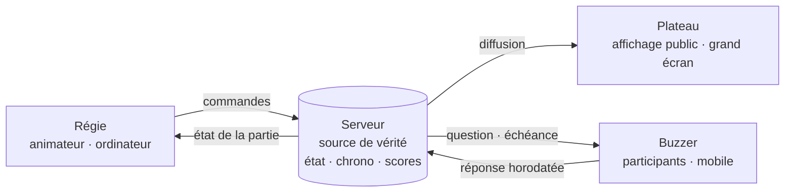

# Défi-Méninges — Vision produit

> **Moteur d'émission TV interactif**

| | |
|---|---|
| **Document** | 1 — Vision produit |
| **Statut** | Brouillon v0.1 |
| **Dernière mise à jour** | 11 octobre 2026 |
| **Porteur** | KovaSoft |

---

## 1. Positionnement

Défi-Méninges n'est pas un quiz de plus. C'est un **moteur d'émission TV interactif** : il donne à n'importe quel animateur les codes d'un jeu télévisé (plateau, régie, chronomètre, révélation, classement) et transforme le téléphone de chaque participant en buzzer.

La promesse tient en une phrase : **un animateur, un écran, une salle qui joue en direct, sans installation.**

### Ce qui nous distingue

- **La mise en scène avant le questionnaire.** Le rythme, la tension et la révélation sont pilotés comme une émission, pas comme un formulaire.
- **L'équité garantie par le serveur.** Le chronomètre et la validation des réponses sont la propriété du serveur, jamais du client.
- **Zéro friction côté participant.** Un code ou un QR code, un pseudo, et on joue. Pas d'application à installer, pas de compte obligatoire.

---

## 2. Vision globale : les 3 modes

Un même moteur de jeu alimente trois expériences. Elles partagent le catalogue de questions, le calcul des scores et le design system. Ce qui les distingue, c'est **qui pilote** le jeu et **où il s'affiche**.

| | Mode Plateau | Mode Salon | Mode Entraînement |
|---|---|---|---|
| **Cible** | B2B et streamers | Groupes d'amis, familles | Joueur individuel |
| **Pilotage** | Un animateur, depuis la Régie | Automatique, l'hôte est un joueur | Automatique |
| **Affichage principal** | Écran public (projecteur, scène, stream) | Écran partagé (TV) ou téléphones seuls | Téléphone ou ordinateur |
| **Enjeu** | Spectacle, cohésion d'équipe, engagement | Convivialité | Découverte, progression |
| **Jalon** | **MVP** | V2 | V3 |

### 2.1 Mode Plateau (MVP)

Le mode phare. C'est l'expérience complète d'un jeu télévisé, pensée pour un **animateur professionnel** face à un public adulte.

**Cibles**
- **B2B** : séminaires d'entreprise, team building, écoles, agences événementielles.
- **Streamers** : animation d'une communauté en direct (Twitch, YouTube Live), où la vue Plateau sert d'incrustation dans le logiciel de diffusion.

**Déroulé type**
1. L'animateur crée une partie depuis la Régie et choisit un thème.
2. Le Plateau affiche le code et le QR code. Les participants rejoignent la partie depuis leur téléphone.
3. L'animateur lance chaque question. Le Plateau l'affiche et le chronomètre démarre.
4. Les participants répondent sur leur Buzzer. Une seule réponse est acceptée, et elle est verrouillée dès qu'elle est envoyée.
5. L'animateur déclenche la révélation : bonne réponse, répartition des votes, puis classement.
6. En fin de partie : podium et récapitulatif.

**Chronomètre anti-triche**

L'équité est une condition non négociable du mode Plateau. Ses règles :

| Règle | Mise en œuvre |
|---|---|
| Le serveur est l'unique source de vérité du temps | Le serveur horodate l'ouverture et la clôture de chaque question. Les clients ne font qu'afficher un compte à rebours. |
| Aucune réponse hors délai | Toute réponse reçue après l'échéance du serveur est rejetée, quoi qu'affiche l'écran du participant. |
| La bonne réponse ne fuit jamais | Le serveur n'envoie la solution aux clients qu'au moment de la révélation. Elle est absente des données transmises pendant la question. |
| Une réponse par participant et par question | Le premier envoi est définitif et les envois suivants sont ignorés. |
| Le score récompense la rapidité de façon équitable | Le temps de réponse se mesure entre l'ouverture de la question côté serveur et la réception de la réponse côté serveur. |

> **Cas des streamers.** Un flux vidéo a plusieurs secondes de retard sur le direct. Le Buzzer affiche donc lui-même la question et ses réponses, de façon synchronisée avec le serveur. Le joueur ne dépend jamais du flux vidéo pour répondre à temps.

### 2.2 Mode Salon (V2)

Une partie **autonome, sans animateur**, entre amis. L'hôte est un joueur comme les autres : il crée la partie et la lance, puis le moteur enchaîne automatiquement questions, révélations et classements.

- Un écran partagé, comme une TV ou un ordinateur, peut servir de Plateau. Il est facultatif : tout peut se jouer uniquement sur les téléphones.
- Le ton reste celui du produit, mais l'interface s'allège : pas de Régie, et les réglages se font avant la partie.

### 2.3 Mode Entraînement (V3)

Une **découverte en solo**, pour apprendre à connaître le jeu et progresser par thème.

- Il sert de porte d'entrée vers les autres modes et de vitrine du catalogue de questions.
- Il mise sur la progression personnelle (meilleurs scores, thèmes maîtrisés), sans dimension compétitive en direct.

---

## 3. Architecture du MVP : les 3 vues

Le mode Plateau repose sur trois vues spécialisées, connectées en temps réel au serveur. Chacune est optimisée pour un appareil et un rôle.

Le serveur détient l'état de la partie. Les trois vues ne font que **le refléter (Plateau), le piloter (Régie) ou l'alimenter (Buzzer)**. Aucune vue ne décide seule d'une transition d'état.

### 3.1 Régie : le tableau de bord de l'animateur

| | |
|---|---|
| **Utilisateur** | L'animateur (compte authentifié) |
| **Appareil** | Ordinateur portable ou tablette, en coulisse |
| **Rôle** | Piloter l'émission |

**Fonctionnalités MVP**
- Créer une partie : thème, langue, nombre de questions, durée du chronomètre.
- Suivre la salle : participants connectés, nombre de réponses en direct pendant une question.
- Piloter : lancer la partie, ouvrir une question, révéler, afficher le classement, passer à la question suivante, terminer.
- Voir la question suivante avant le public, pour préparer son intervention.
- Garder la main en cas de problème : mettre en pause, retirer un participant.

**Exigences**
- Des commandes lisibles et utilisables sous pression, avec des actions principales accessibles en un geste.
- Un retour immédiat et sans ambiguïté sur l'état courant de la partie.

### 3.2 Plateau : l'affichage public

| | |
|---|---|
| **Utilisateur** | Le public (aucune interaction) |
| **Appareil** | Vidéoprojecteur, écran de scène, incrustation dans un stream |
| **Rôle** | Mettre en scène |

**Fonctionnalités MVP**
- Lobby : code de la partie, QR code, adresse, participants qui arrivent.
- Question : énoncé, réponses, chronomètre, compteur de réponses reçues.
- Révélation : bonne réponse, répartition des votes.
- Classement intermédiaire, puis podium final.

**Exigences**
- Lisible à distance : hiérarchie typographique forte, contenu minimal à l'écran.
- Format 16:9 en plein écran, adapté au mode présentateur.
- Un fond compatible avec une incrustation dans un logiciel de diffusion, pour les streamers.
- Des transitions et des retours visuels qui portent la tension : compte à rebours, révélation, podium.

### 3.3 Buzzer : la Web App mobile

| | |
|---|---|
| **Utilisateur** | Le participant (invité, sans compte) |
| **Appareil** | Smartphone personnel |
| **Rôle** | Répondre, vite |

**Fonctionnalités MVP**
- Rejoindre la partie : code ou QR code, puis pseudo.
- Afficher la question et ses réponses, synchronisées avec le serveur.
- Répondre d'un seul geste, avec confirmation immédiate du verrouillage.
- Voir son résultat (bonne ou mauvaise réponse, points gagnés) et sa position au classement.

**Exigences (objectifs à valider en tests)**
- **Ultra-rapide** : affichage utilisable en moins de 2 secondes sur un réseau mobile moyen, et une page la plus légère possible.
- **Une main, un pouce** : grandes zones tactiles, rien d'important hors de portée.
- **Robuste** : reconnexion automatique sans perte de la partie ni du score après une coupure réseau ou un écran mis en veille.
- **Sans installation** : une Web App ouverte depuis le navigateur.

### 3.4 Correspondance avec l'existant

| Concept produit | Socle actuel | Évolution à prévoir |
|---|---|---|
| Animateur (Régie) | `Game.host`, utilisateur authentifié via JWT | Restreindre les commandes de pilotage à l'hôte |
| Modes | `GameMode` : `SOLO`, `MULTIPLAYER` | Faire évoluer vers `PLATEAU`, `SALON`, `ENTRAINEMENT` |
| Cycle de vie | `GameStatus` : `WAITING`, `IN_PROGRESS`, `FINISHED` | Ajouter des états fins : question ouverte, close, révélée, classement |
| Participant (Buzzer) | Compte utilisateur obligatoire | Rendre possible l'accès invité, avec un simple pseudo |
| Temps réel | Requêtes REST | Canal temps réel (WebSocket) entre le serveur et les trois vues |
| Questions | Les entités contiennent la bonne réponse | Des DTO qui ne transmettent jamais la solution avant la révélation |

---

## 4. Identité visuelle

### 4.1 Intentions

| Principe | Traduction |
|---|---|
| **Dark mode immersif** | Un environnement sombre natif qui fait ressortir le contenu, comme sur un plateau éclairé. Ce n'est pas un thème clair inversé. |
| **Touche organique** | Des textures (grain, matière) et une typographie de caractère qui évitent l'aspect froid et générique d'une interface SaaS. |
| **Ambiance plateau TV** | La lumière, le rythme, la tension du chronomètre et le moment de la révélation font partie du design. |
| **Premium et adulte** | Rien d'enfantin ni de cartoon. Le public est professionnel. |

### 4.2 Charte graphique

> **Statut : en cours de test (à définir).**
> La palette de couleurs, les typographies et la charte graphique sont en phase d'exploration visuelle. **Aucune valeur n'est figée dans ce document.** Elles seront arrêtées à l'issue des tests et documentées dans un document dédié au design system.

Les points en cours d'évaluation :
- la palette (fond, surfaces, couleur d'accent, états de réponse) ;
- le couple de typographies (titres de caractère, texte courant, chiffres du chronomètre et des scores) ;
- le traitement des textures et de la matière ;
- le langage de mouvement (compte à rebours, révélation, podium).

### 4.3 Exigences fixes, quelle que soit la charte retenue

- **Contraste** : conformité WCAG 2.1 AA au minimum pour tout texte, et une lisibilité vérifiée sur vidéoprojecteur.
- **La couleur ne suffit jamais** : chaque réponse est identifiable sans la couleur (lettre, position, forme).
- **Des tokens comme source unique** : couleurs, espacements, rayons et typographies sont définis sous forme de tokens partagés par toutes les vues. Aucune valeur n'est codée en dur dans les composants.
- **Un mouvement maîtrisé** : les animations respectent la préférence système de réduction des animations.

---

## 5. Périmètre du MVP

### Inclus
- Le mode Plateau complet, avec ses trois vues : Régie, Plateau, Buzzer.
- Le chronomètre anti-triche, géré par le serveur.
- L'accès des participants sans compte, par code ou QR code.
- Un catalogue de questions par thème, en français et en anglais.
- Les scores, le classement intermédiaire et le podium.

### Exclus (versions ultérieures)
- Le mode Salon et le mode Entraînement.
- La création de questionnaires personnalisés par l'animateur.
- La personnalisation à la marque du client (logo, couleurs de l'événement).
- L'export des résultats et les statistiques après l'événement.
- La facturation et les offres.

---

## 6. Indicateurs de succès

Les valeurs cibles seront fixées après les premiers tests en conditions réelles.

| Indicateur | Ce qu'il mesure |
|---|---|
| Temps pour rejoindre | Délai entre le scan du QR code et l'arrivée du participant dans le lobby |
| Taux de participation | Part des participants connectés qui répondent à chaque question |
| Latence de réponse | Délai entre l'envoi d'une réponse et la confirmation de son verrouillage |
| Parties menées à terme | Part des parties lancées qui atteignent le podium |
| Réutilisation | Part des animateurs qui organisent une deuxième partie |

---

## 7. Risques et questions ouvertes

| Sujet | Risque ou question | Piste |
|---|---|---|
| Réseau en salle | Wi-Fi saturé lors d'un événement de plusieurs centaines de personnes | Buzzer très léger, reconnexion automatique, messages temps réel minimaux |
| Retard des streams | Le public d'un stream voit la question avec du retard | La question s'affiche sur le Buzzer, synchronisée avec le serveur (voir 2.1) |
| Montée en charge | De nombreux participants simultanés sur une même partie | Valider l'architecture temps réel par des tests de charge avant le lancement |
| Identité des invités | Des pseudos inappropriés affichés sur grand écran | L'animateur peut retirer un participant, et un filtrage pourra être ajouté |
| Charte graphique | Pas encore arrêtée | Phase de tests visuels en cours (voir 4.2) |

---

## 8. Feuille de route

| Phase | Objectif | Contenu |
|---|---|---|
| **0 — Socle** | Fondations techniques | Authentification, parties, hôte, gestion des erreurs, profils d'environnement *(fait)* |
| **1 — Design** | Identité et design system | Tests visuels, charte arrêtée, tokens, composants clés |
| **2 — MVP Plateau** | Première émission jouable | Temps réel, Régie, Plateau, Buzzer, chronomètre anti-triche, scores |
| **3 — Mise en production** | Fiabilité | Migrations de schéma, tests automatisés, CI/CD, tests de charge, supervision |
| **4 — Mode Salon** | Usage grand public | Jeu autonome, écran partagé facultatif |
| **5 — Mode Entraînement** | Découverte | Parcours solo, progression |

---

## 9. Glossaire

| Terme | Définition |
|---|---|
| **Animateur** | La personne qui pilote la partie depuis la Régie. C'est l'hôte de la partie. |
| **Participant** | Une personne qui joue depuis son Buzzer. |
| **Régie** | La vue de pilotage réservée à l'animateur. |
| **Plateau** | La vue publique projetée ou diffusée. C'est aussi le nom du mode B2B et streamers. |
| **Buzzer** | La Web App mobile du participant. |
| **Révélation** | Le moment où la bonne réponse et la répartition des votes sont dévoilées. |
| **Code de partie** | L'identifiant court qu'on saisit pour rejoindre une partie. |
