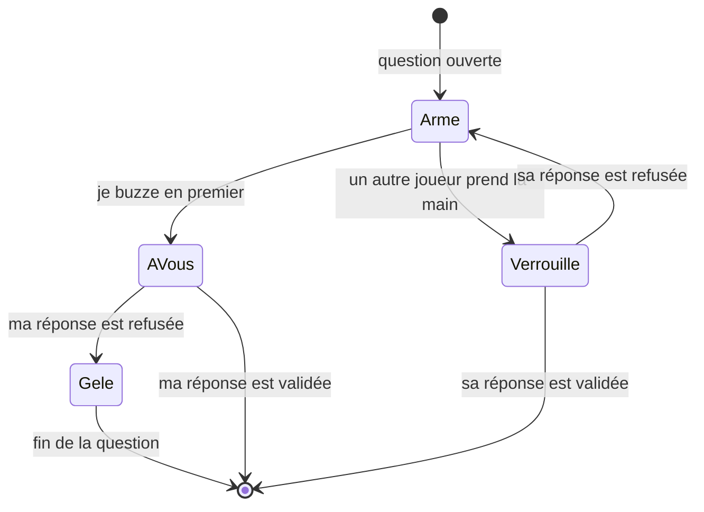
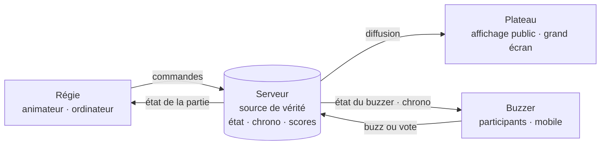

# Défi-Méninges — Vision produit

> **Moteur d'émission TV interactif**

| | |
|---|---|
| **Document** | 1 — Vision produit |
| **Statut** | Brouillon v0.3 (variantes Présentiel et Streaming du mode Plateau) |
| **Dernière mise à jour** | 11 octobre 2026 |
| **Porteur** | KovaSoft |

---

## 1. Positionnement

Défi-Méninges n'est pas un quiz de plus. C'est un **moteur d'émission TV interactif** : il donne à n'importe quel animateur les codes d'un jeu télévisé (plateau, régie, chronomètre, révélation, classement) et transforme le téléphone de chaque participant en buzzer.

La promesse tient en une phrase : **un animateur, un écran, une salle qui joue en direct, sans installation.**

### Ce qui nous distingue

- **La mise en scène avant le questionnaire.** Le rythme, la tension et la révélation sont pilotés comme une émission, pas comme un formulaire.
- **L'équité garantie par le serveur.** Le chronomètre et la validation des réponses sont la propriété du serveur, jamais du client.
- **Zéro friction côté participant.** Un code ou un QR code, un pseudo, et on joue. Pas d'application à installer, pas de compte obligatoire.

---

## 2. Vision globale : les 3 modes

Un même moteur de jeu alimente trois expériences. Elles partagent le catalogue de questions, le calcul des scores et le design system. Ce qui les distingue, c'est **qui pilote** le jeu et **où il s'affiche**.

| | Mode Plateau | Mode Salon | Mode Entraînement |
|---|---|---|---|
| **Cible** | B2B et streamers | Groupes d'amis, familles | Joueur individuel |
| **Pilotage** | Un animateur, depuis la Régie | Automatique, l'hôte est un joueur | Automatique |
| **Affichage principal** | Écran public (projecteur, scène, stream) | Écran partagé (TV) ou téléphones seuls | Téléphone ou ordinateur |
| **Enjeu** | Spectacle, cohésion d'équipe, engagement | Convivialité | Découverte, progression |
| **Jalon** | **MVP** | V2 | V3 |

### 2.1 Mode Plateau (MVP)

Le mode phare. C'est l'expérience complète d'un jeu télévisé, pensée pour un **animateur professionnel** face à un public adulte.

**Cibles**
- **B2B** : séminaires d'entreprise, team building, écoles, agences événementielles.
- **Streamers** : animation d'une communauté en direct (Twitch, TikTok Live, YouTube Live), où la vue Plateau sert d'incrustation dans le logiciel de diffusion.

**Deux variantes, choisies par l'animateur depuis la Régie à la création de la partie**

Un flux vidéo a plusieurs secondes de retard sur le direct. Un même mécanisme ne peut donc pas être équitable à la fois pour une salle et pour le public d'un stream. Le mode Plateau se décline en deux variantes :

| | Variante Présentiel | Variante Streaming |
|---|---|---|
| **Contexte** | Public dans la même salle que le Plateau | Public derrière un flux vidéo différé |
| **Téléphone** | Buzzer pur : un seul bouton BUZZ | QCM synchronisé : 4 gros boutons A, B, C, D |
| **Qui répond** | Le premier qui buzze, à voix haute | Tout le public, en même temps |
| **Arbitrage** | L'animateur valide ou refuse | Automatique, par le serveur |
| **Points** | Bonne réponse du joueur qui a la main | Bonne réponse, pondérée par la rapidité |
| **Chronomètre** | Affiché sur le Plateau | Synchronisé par le serveur directement sur les téléphones |
| **Révélation** | Bonne réponse et pseudo du joueur le plus rapide, **sans pourcentages** | Bonne réponse et **pourcentages** de votes par proposition |
| **Dépendance à la vidéo** | Aucune, la salle voit le Plateau en direct | Aucune, le téléphone porte le chronomètre |

Déroulé commun :
1. L'animateur crée une partie depuis la Régie, choisit un thème et la variante.
2. Le Plateau affiche le code et le QR code. Les participants rejoignent la partie depuis leur téléphone.
3. L'animateur lance chaque question. Le Plateau affiche la question et ses quatre propositions (A, B, C, D), et le chronomètre démarre.
4. La suite dépend de la variante (voir 2.1.1 et 2.1.2).
5. Après chaque question : révélation, puis classement. En fin de partie : podium et récapitulatif.

#### 2.1.1 Variante Présentiel : le buzzer pur

**Principe.** Il n'y a aucune latence vidéo, puisque la salle voit le Plateau en direct. Le téléphone est un simple bouton BUZZ, sans question ni proposition à l'écran : le regard reste sur le Plateau et sur l'animateur.

**Déroulé d'une question**
1. Le premier participant à buzzer **prend la main**, et les autres buzzers sont verrouillés.
2. Il donne sa réponse à voix haute.
3. L'animateur valide ou refuse depuis la Régie.
4. Révélation : la bonne réponse s'allume sur le Plateau, avec le **pseudo du joueur le plus rapide**. Aucun pourcentage n'est affiché, puisqu'un seul joueur avait le droit de répondre.

**Règles de buzz et anti-spam**

| Situation | Effet |
|---|---|
| Un participant buzze en premier | Il prend la main. Tous les autres buzzers sont verrouillés instantanément. |
| La réponse est **bonne** | Le participant marque les points, puis la question passe à la révélation. |
| La réponse est **mauvaise** | Le participant est **gelé** : son buzzer reste bloqué jusqu'à la fin de la question. Les buzzers des autres participants non gelés sont **réactivés instantanément**. |
| Tous les participants sont gelés, ou le chronomètre arrive à zéro | Les buzzers sont désactivés, et l'animateur déclenche la révélation sans vainqueur. |

États d'un buzzer pendant une question :

#### 2.1.2 Variante Streaming : le QCM synchronisé

**Principe.** Le public d'un stream voit la question plusieurs secondes après le direct. Pour neutraliser ce retard, le serveur pousse l'ouverture de la question et son échéance **directement sur les téléphones**, qui affichent leur propre compte à rebours. Le joueur ne dépend plus de la vidéo pour savoir combien de temps il lui reste.

**Déroulé d'une question**
1. À l'ouverture, chaque téléphone affiche 4 gros boutons A, B, C, D et le chronomètre synchronisé.
2. Tout le public vote. Le premier choix est définitif et verrouillé dès l'appui.
3. À l'échéance, le serveur clôt les votes et calcule les points : une bonne réponse rapporte d'autant plus qu'elle a été donnée tôt.
4. Révélation : la bonne réponse s'allume, avec les **pourcentages** de votes de chaque proposition.

> **Point d'attention.** Si le téléphone n'affiche que les lettres, le joueur doit toujours lire la question sur le stream différé. Le chronomètre est alors équitable, mais le temps de lecture ne l'est pas. Pour une indépendance totale, le téléphone devra aussi afficher l'énoncé et le texte des propositions, de façon compacte. Ce point est à valider en test (voir section 7).

#### 2.1.3 Chronomètre anti-triche

L'équité est une condition non négociable du mode Plateau, quelle que soit la variante.

| Règle | Variante | Mise en œuvre |
|---|---|---|
| Le serveur est l'unique source de vérité du temps | Les deux | Le serveur horodate l'ouverture et la clôture de chaque question. Les clients ne font qu'afficher un compte à rebours. |
| Aucune action hors délai | Les deux | Un buzz ou un vote reçu avant l'ouverture ou après l'échéance est ignoré. |
| La bonne réponse ne fuit jamais | Les deux | Le serveur n'envoie la solution aux clients qu'au moment de la révélation. |
| Le serveur arbitre l'ordre des buzz | Présentiel | La main revient au premier buzz **reçu par le serveur**. L'horloge du téléphone n'entre jamais en compte. |
| Le gel est appliqué par le serveur | Présentiel | L'état « gelé » est conservé côté serveur. Recharger la page ou se reconnecter ne le lève pas. |
| Un vote par joueur et par question | Streaming | Le premier vote reçu est définitif, les suivants sont rejetés. |
| La rapidité se mesure côté serveur | Streaming | Le temps de réponse va de l'ouverture de la question à la réception du vote, tous deux mesurés par le serveur. |
| Le chronomètre du téléphone est recalé sur le serveur | Streaming | Le téléphone corrige l'écart entre son horloge et celle du serveur. Il n'affiche jamais une échéance plus tardive que celle du serveur. |

### 2.2 Mode Salon (V2)

Une partie **autonome, sans animateur**, entre amis. L'hôte est un joueur comme les autres : il crée la partie et la lance, puis le moteur enchaîne automatiquement questions, révélations et classements.

- Un écran partagé, comme une TV ou un ordinateur, peut servir de Plateau. Il est facultatif : tout peut se jouer uniquement sur les téléphones.
- Le ton reste celui du produit, mais l'interface s'allège : pas de Régie, et les réglages se font avant la partie.

### 2.3 Mode Entraînement (V3)

Une **découverte en solo**, pour apprendre à connaître le jeu et progresser par thème.

- Il sert de porte d'entrée vers les autres modes et de vitrine du catalogue de questions.
- Il mise sur la progression personnelle (meilleurs scores, thèmes maîtrisés), sans dimension compétitive en direct.

---

## 3. Architecture du MVP : les 3 vues

Le mode Plateau repose sur trois vues spécialisées, connectées en temps réel au serveur. Chacune est optimisée pour un appareil et un rôle.

Le serveur détient l'état de la partie. Les trois vues ne font que **le refléter (Plateau), le piloter (Régie) ou l'alimenter (Buzzer)**. Aucune vue ne décide seule d'une transition d'état.

### 3.1 Régie : le tableau de bord de l'animateur

| | |
|---|---|
| **Utilisateur** | L'animateur (compte authentifié) |
| **Appareil** | Ordinateur portable ou tablette, en coulisse |
| **Rôle** | Piloter l'émission |

**Fonctionnalités MVP**
- Créer une partie : thème, langue, nombre de questions, durée du chronomètre, et **variante (Présentiel ou Streaming)**.
- Suivre la salle : participants connectés. En Présentiel : joueur qui a la main et joueurs gelés. En Streaming : nombre de votes reçus en direct.
- Arbitrer, en Présentiel uniquement : **valider** ou **refuser** la réponse orale du joueur qui a la main, en un seul geste.
- Piloter : lancer la partie, ouvrir une question, révéler, afficher le classement, passer à la question suivante, terminer.
- Voir la question suivante avant le public, pour préparer son intervention.
- Garder la main en cas de problème : mettre en pause, retirer un participant.

**Exigences**
- Des commandes lisibles et utilisables sous pression, avec des actions principales accessibles en un geste.
- Un retour immédiat et sans ambiguïté sur l'état courant de la partie.

### 3.2 Plateau : l'affichage public

| | |
|---|---|
| **Utilisateur** | Le public (aucune interaction) |
| **Appareil** | Vidéoprojecteur, écran de scène, incrustation dans un stream |
| **Rôle** | Mettre en scène |

**Fonctionnalités MVP**
- Lobby : code de la partie, QR code, adresse, participants qui arrivent.
- Question : énoncé, quatre propositions en grille 2×2, chronomètre géant.
- Prise de main, en Présentiel : nom du joueur qui a buzzé, et indication des joueurs gelés.
- Révélation : la bonne réponse s'allume, les autres propositions restent en retrait.
  - En Présentiel : mention du joueur le plus rapide (« Remporté par … »), **sans pourcentages**.
  - En Streaming : **pourcentage** de votes sous chaque proposition.
- Classement intermédiaire, puis podium final.

**Exigences**
- Lisible à distance : hiérarchie typographique forte, contenu minimal à l'écran.
- Format 16:9 en plein écran, adapté au mode présentateur.
- Un fond compatible avec une incrustation dans un logiciel de diffusion, pour les streamers.
- Des transitions et des retours visuels qui portent la tension : compte à rebours, révélation, podium.

### 3.3 Buzzer : la Web App mobile

| | |
|---|---|
| **Utilisateur** | Le participant (invité, sans compte) |
| **Appareil** | Smartphone personnel |
| **Rôle** | Agir le plus vite possible |

Le Buzzer adopte l'une des deux dispositions, selon la variante choisie par l'animateur.

| | Présentiel : buzzer pur | Streaming : QCM synchronisé |
|---|---|---|
| **Écran** | Un seul gros bouton BUZZ, sans question ni proposition | 4 gros boutons A, B, C, D et un chronomètre |
| **États** | Armé, verrouillé (un autre joueur a la main), à vous, gelé | Ouvert, choix verrouillé, clos |
| **Chronomètre** | Non affiché : il est sur le Plateau | Affiché et recalé sur le serveur |

**Fonctionnalités MVP communes**
- Rejoindre la partie : code ou QR code, puis pseudo.
- Un retour immédiat à l'appui : animation d'enfoncement et vibration quand l'appareil le permet.
- Entre les questions : résultat personnel et position au classement.

**Exigences (objectifs à valider en tests)**
- **Ultra-rapide** : affichage utilisable en moins de 2 secondes sur un réseau mobile moyen, et une page la plus légère possible.
- **Une main, un pouce** : grandes zones tactiles, rien d'important hors de portée.
- **Robuste** : reconnexion automatique sans perte de la partie ni du score après une coupure réseau ou un écran mis en veille.
- **Sans installation** : une Web App ouverte depuis le navigateur.

### 3.4 Correspondance avec l'existant

| Concept produit | Socle actuel | Évolution à prévoir |
|---|---|---|
| Animateur (Régie) | `Game.host`, utilisateur authentifié via JWT | Restreindre les commandes de pilotage à l'hôte |
| Modes | `GameMode` : `SOLO`, `MULTIPLAYER` | Faire évoluer vers `PLATEAU`, `SALON`, `ENTRAINEMENT`, avec une variante `PRESENTIEL` ou `STREAMING` pour `PLATEAU` |
| Cycle de vie | `GameStatus` : `WAITING`, `IN_PROGRESS`, `FINISHED` | Ajouter des états fins : question ouverte, close, révélée, classement |
| Participant (Buzzer) | Compte utilisateur obligatoire | Rendre possible l'accès invité, avec un simple pseudo |
| Temps réel | Requêtes REST | Canal temps réel (WebSocket) entre le serveur et les trois vues |
| Questions | Les entités contiennent la bonne réponse | Des DTO qui ne transmettent jamais la solution avant la révélation |
| Buzz (Présentiel) | Inexistant | Un événement de buzz arbitré par le serveur, avec l'état de chaque joueur (armé, verrouillé, main, gelé) par question |
| Vote (Streaming) | Inexistant | Un vote par joueur et par question, horodaté par le serveur, avec un score pondéré par la rapidité |

---

## 4. Identité visuelle

### 4.1 Intentions

| Principe | Traduction |
|---|---|
| **Dark mode immersif** | Un environnement sombre natif qui fait ressortir le contenu, comme sur un plateau éclairé. Ce n'est pas un thème clair inversé. |
| **Touche organique** | Des textures (grain, matière) et une typographie de caractère qui évitent l'aspect froid et générique d'une interface SaaS. |
| **Ambiance plateau TV** | La lumière, le rythme, la tension du chronomètre et le moment de la révélation font partie du design. |
| **Premium et adulte** | Rien d'enfantin ni de cartoon. Le public est professionnel. |

### 4.2 Charte graphique

> **Statut : validée à l'issue des tests visuels (11 octobre 2026).**
> Les valeurs ci-dessous sont déclarées une seule fois, sous forme de tokens dans `frontend/tailwind.config.js`. Les composants n'utilisent que ces tokens, jamais de valeur hexadécimale.

**Couleurs**

| Token | Rôle | Valeur |
|---|---|---|
| `stage` | Fond de scène, le plus sombre | `#0A0A0A` |
| `stage-mid`, `stage-light` | Paliers du dégradé de projecteur | `#141414`, `#2A2A2A` |
| `surface` | Cartes, blocs | `#171717` |
| `surface-raised` | Éléments en relief (lettres, barres en retrait) | `#262626` |
| `surface-sunken` | Zones en creux (fond du Buzzer) | `#0A0A0A` |
| `ink` | Texte principal | `#FFFFFF` |
| `ink-muted` | Texte secondaire, propositions en retrait | `#A3A3A3` |
| `ink-subtle` | Texte décoratif uniquement, jamais pour une information | `#737373` |
| `ruby` | **Accent signature (Rubis Intense)** : bonne réponse, Buzzer, chronomètre | `#BE123C` |
| `ruby-bright` | Survol et état actif de l'accent | `#E11D48` |
| `ruby-deep` | Épaisseur du Buzzer, ombres | `#881337` |

Le rubis est réservé aux aplats portant un texte blanc (contraste de 7,6:1). Il ne sert jamais de couleur de texte sur un fond sombre, où il serait illisible.

**Typographie**

| Usage | Police |
|---|---|
| Chiffres et mots-signal (chronomètre, « BUZZ », scores) | **Barlow Condensed**, graisse 600 à 800 (token `font-display`) |
| Questions, propositions, interface | Police système sans-serif |

**Matière et lumière**

| Élément | Traitement |
|---|---|
| Fond | Dégradé radial centré en haut, qui simule un projecteur de scène (token `bg-spotlight`) |
| Ombres de l'accent | Douces, portées vers le bas, sans effet néon (tokens `shadow-ruby-soft`, `shadow-ruby-line`) |
| Buzzer | Bouton d'arcade en relief qui s'enfonce à l'appui (tokens `shadow-buzzer`, `shadow-buzzer-pressed`) |
| Révélation | La bonne réponse passe en rubis, les autres restent en gris terne. En Présentiel, une mention discrète nomme le vainqueur. En Streaming, les pourcentages s'affichent. |

**Encore à définir :** le langage de mouvement (compte à rebours, révélation, podium) et le visuel des états verrouillé et gelé du Buzzer.

### 4.3 Exigences fixes, quelle que soit la charte retenue

- **Contraste** : conformité WCAG 2.1 AA au minimum pour tout texte, et une lisibilité vérifiée sur vidéoprojecteur.
- **La couleur ne suffit jamais** : chaque réponse est identifiable sans la couleur (lettre, position, forme).
- **Des tokens comme source unique** : couleurs, espacements, rayons et typographies sont définis sous forme de tokens partagés par toutes les vues. Aucune valeur n'est codée en dur dans les composants.
- **Un mouvement maîtrisé** : les animations respectent la préférence système de réduction des animations.

---

## 5. Périmètre du MVP

### Inclus
- Le mode Plateau complet, avec ses trois vues (Régie, Plateau, Buzzer) et ses deux variantes (Présentiel, Streaming).
- Le chronomètre anti-triche, géré par le serveur.
- L'accès des participants sans compte, par code ou QR code.
- Un catalogue de questions par thème, en français et en anglais.
- Les scores, le classement intermédiaire et le podium.

### Exclus (versions ultérieures)
- Le mode Salon et le mode Entraînement.
- La création de questionnaires personnalisés par l'animateur.
- La personnalisation à la marque du client (logo, couleurs de l'événement).
- L'export des résultats et les statistiques après l'événement.
- La facturation et les offres.

---

## 6. Indicateurs de succès

Les valeurs cibles seront fixées après les premiers tests en conditions réelles.

| Indicateur | Ce qu'il mesure |
|---|---|
| Temps pour rejoindre | Délai entre le scan du QR code et l'arrivée du participant dans le lobby |
| Taux de participation | Présentiel : part des participants qui buzzent au moins une fois par partie. Streaming : part des connectés qui votent à chaque question. |
| Latence de buzz ou de vote | Délai entre l'appui sur le téléphone et la confirmation reçue du serveur |
| Parties menées à terme | Part des parties lancées qui atteignent le podium |
| Réutilisation | Part des animateurs qui organisent une deuxième partie |

---

## 7. Risques et questions ouvertes

| Sujet | Risque ou question | Piste |
|---|---|---|
| Réseau en salle | Wi-Fi saturé lors d'un événement de plusieurs centaines de personnes | Buzzer très léger, reconnexion automatique, messages temps réel minimaux |
| Retard des streams | Le public d'un stream découvre la question plusieurs secondes après le direct | **Résolu** par la variante Streaming : le chronomètre est porté par le téléphone. Il reste à valider en test si l'énoncé doit aussi s'afficher sur le téléphone (voir 2.1.2). |
| Mauvaise variante choisie | Un animateur lance la variante Présentiel devant un public en stream | La Régie explique clairement les deux variantes à la création de la partie |
| Équité réseau | Un participant sur un réseau lent buzze plus tard qu'il n'a appuyé | Mesurer l'écart réel en tests avant d'envisager une compensation de latence |
| Arbitrage oral | Une réponse donnée à voix haute est mal entendue dans une salle bruyante | L'animateur reste seul juge. Il faudra étudier un micro de scène ou l'affichage de la lettre choisie |
| Montée en charge | De nombreux participants simultanés sur une même partie | Valider l'architecture temps réel par des tests de charge avant le lancement |
| Identité des invités | Des pseudos inappropriés affichés sur grand écran | L'animateur peut retirer un participant, et un filtrage pourra être ajouté |
| Charte graphique | Le mouvement et les états du Buzzer ne sont pas encore définis | À traiter avec les écrans du MVP (voir 4.2) |

---

## 8. Feuille de route

| Phase | Objectif | Contenu |
|---|---|---|
| **0 — Socle** | Fondations techniques | Authentification, parties, hôte, gestion des erreurs, profils d'environnement *(fait)* |
| **1 — Design** | Identité et design system | Tests visuels et charte *(faits)*, tokens Tailwind *(faits)*, preset PrimeNG, composants clés |
| **2 — MVP Plateau** | Première émission jouable | Temps réel, Régie, Plateau, Buzzer, chronomètre anti-triche, scores |
| **3 — Mise en production** | Fiabilité | Migrations de schéma, tests automatisés, CI/CD, tests de charge, supervision |
| **4 — Mode Salon** | Usage grand public | Jeu autonome, écran partagé facultatif |
| **5 — Mode Entraînement** | Découverte | Parcours solo, progression |

---

## 9. Glossaire

| Terme | Définition |
|---|---|
| **Animateur** | La personne qui pilote la partie depuis la Régie. C'est l'hôte de la partie. |
| **Participant** | Une personne qui joue depuis son Buzzer. |
| **Régie** | La vue de pilotage réservée à l'animateur. |
| **Plateau** | La vue publique projetée ou diffusée. C'est aussi le nom du mode B2B et streamers. |
| **Buzzer** | La Web App mobile du participant. |
| **Buzz** | L'appui d'un participant sur son Buzzer pour demander la parole. |
| **Main** | Le droit de répondre, accordé au premier buzz reçu par le serveur. |
| **Gel** | En Présentiel, le blocage du Buzzer d'un participant jusqu'à la fin de la question, après une mauvaise réponse. |
| **Présentiel** | Variante du mode Plateau pour un public dans la salle : buzzer pur et arbitrage par l'animateur. |
| **Streaming** | Variante du mode Plateau pour un public derrière un flux vidéo : QCM synchronisé et vote de tout le public. |
| **Révélation** | Le moment où la bonne réponse est dévoilée sur le Plateau. |
| **Code de partie** | L'identifiant court qu'on saisit pour rejoindre une partie. |
